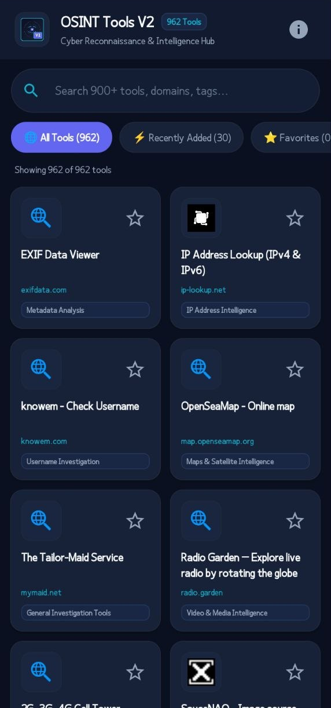
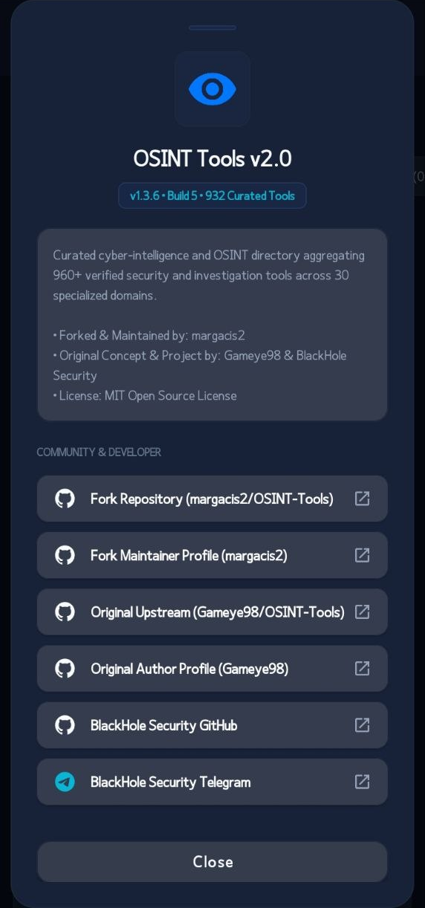

# OSINT Tools V2

<p align="center">
  <b>A modern Android application for discovering and accessing Open-Source Intelligence (OSINT) resources.</b><br>
  Search, explore, organize, and access hundreds of publicly available intelligence resources from one place.
</p>

<p align="center">
  <a href="https://github.com/margacis2/OSINT-Tools/releases">
    
  </a>
  <a href="https://github.com/margacis2/OSINT-Tools/stargazers">
    
  </a>
  
  
  <a href="https://github.com/Gameye98/OSINT-Tools">
    
  </a>
</p>

## Overview

OSINT Tools V2 is a redesigned and expanded fork of the original [Gameye98/OSINT-Tools](https://github.com/Gameye98/OSINT-Tools) Android project.

It provides a categorized directory of publicly accessible OSINT websites and investigation resources. Instead of manually searching for individual services, users can browse resources by category, search for specific tools, save favorites, and open websites through an integrated browser.

This version focuses on improving the Android user experience, organizing resources, and making the application easier to navigate.

---

## Screenshots

<p align="center">
  
  
  
</p>
<p align="center">
  <sub><b>Home</b></sub> &nbsp;&nbsp;&nbsp;&nbsp;&nbsp;&nbsp;
  <sub><b>Categories</b></sub> &nbsp;&nbsp;&nbsp;&nbsp;&nbsp;&nbsp;
  <sub><b>Favorites</b></sub>
</p>

<p align="center">
  
  
  
</p>
<p align="center">
  <sub><b>Tool Details</b></sub> &nbsp;&nbsp;&nbsp;&nbsp;
  <sub><b>Browser</b></sub> &nbsp;&nbsp;&nbsp;&nbsp;&nbsp;
  <sub><b>About</b></sub>
</p>

---

## Features

### Modern Android Interface
- Redesigned application interface.
- Dark-themed visual design.
- Responsive tool cards and adaptive grid layout.
- RecyclerView-based resource display.
- Improved navigation and filtering experience.
- Resource icons and visual details.

### OSINT Resource Directory
- 932 records in the original resource directory.
- 30 additional resource records.
- 962 total resource records across both data files.
- Resource names, website addresses, and available icons.
- Support for multiple category assignments.

### Search and Filtering
- Search resources by name.
- Search by website URL and domain.
- Filter resources by category.
- Display matching resource counts.
- Reset filters and clear searches.

### Categories
The application provides 27 investigative categories:

| Category | Category |
| :--- | :--- |
| People Search | Social Media Intelligence |
| Username Investigation | Email Intelligence |
| Phone Number Intelligence | Domain Intelligence |
| DNS & Subdomain Enumeration | IP Address Intelligence |
| Network Reconnaissance | Geolocation Intelligence |
| Maps & Satellite Intelligence | Image Intelligence |
| Reverse Image Search | Video & Media Intelligence |
| Metadata Analysis | Dark Web Monitoring Resources |
| Threat Intelligence | Malware Analysis Resources |
| Data Breach Research | Digital Forensics |
| Archive & Historical Research | Search Engines & Google Dorks |
| Cryptocurrency Intelligence | Company & Business Intelligence |
| Public Records Research | Developer & Code Intelligence |
| General Investigation Tools | |

Additional navigation filters:
- All Tools
- Recently Added
- Favorites

### Favorites
- Save useful OSINT resources.
- Remove saved resources.
- Access favorites from a dedicated filter.
- Store favorites locally on the device.

### Resource Details
- View resource name and domain.
- View the complete website address.
- See available category and resource information.
- Copy website URLs.
- Share URLs using Android sharing.
- Add or remove favorites.
- Open resources internally or externally.

### Integrated Browser
- Built-in Android WebView browser.
- Page loading progress.
- Website title and URL display.
- Back and forward navigation.
- Reload and retry functionality.
- Desktop browsing mode.
- File upload support.
- DownloadManager integration.
- External application link handling.
- WebView renderer-crash recovery and error handling.

### Recently Added Resources
An additional collection of 30 resources is maintained separately in `recent_tools.dat`.

Examples include:
- WhatsMyName
- Epieos
- Have I Been Pwned
- Intelligence X
- urlscan.io
- CyberChef
- Web-Check
- Shodan
- Censys
- VirusTotal
- Sherlock
- Maigret
- PhoneInfoga
- SpiderFoot

---

## Resource Statistics

| Resource collection | Records |
| :--- | :--- |
| Original directory | 932 |
| Additional resources | 30 |
| **Total** | **962** |

*The counts represent records in the application's bundled resource files, not necessarily 962 unique services.*

---

## App Information

| Property | Details |
| :--- | :--- |
| Application name | OSINT Tools V2 |
| Package ID | `com.margacis2.osinttools` |
| Original package ID | `com.gameye98.osint` |
| Platform | Android |
| Language | Java |
| Minimum SDK | 21 |
| Target SDK | 34 |
| Java compatibility | Java 17 |

*Separate installation: OSINT Tools V2 uses a different application ID from the original Gameye98 application. Both applications can therefore be installed independently on the same Android device.*

---

## Download and Installation

Get the available APK builds from:  
👉 **[Download OSINT Tools V2 — GitHub Releases](https://github.com/margacis2/OSINT-Tools/releases)**

1. Open the Releases page.
2. Download the available APK.
3. Open the APK on your Android device.
4. Allow installation from the relevant source if prompted.
5. Install and launch OSINT Tools V2.

*The original Gameye98 application does not need to be uninstalled.*

---

## Build from Source

### Requirements
- JDK 17
- Android Studio or Android SDK
- Android SDK Platform 34
- Gradle Wrapper included in the repository

### Clone the repository
```bash
git clone https://github.com/margacis2/OSINT-Tools.git
cd OSINT-Tools
```

### Run unit tests
**Windows:**
```powershell
.\gradlew.bat testDebugUnitTest
```
**Linux/macOS:**
```bash
./gradlew testDebugUnitTest
```

### Build Debug APK
**Windows:**
```powershell
.\gradlew.bat assembleDebug
```
**Linux/macOS:**
```bash
./gradlew assembleDebug
```

### Build Release APK
**Windows:**
```powershell
.\gradlew.bat assembleRelease
```
**Linux/macOS:**
```bash
./gradlew assembleRelease
```

### APK output
```text
app/build/outputs/apk/
├── debug/
│   └── app-debug.apk
└── release/
    └── app-release.apk
```

*A release build may require the appropriate signing configuration.*

---

## Project Structure

```text
OSINT-Tools/
│
├── app/
│   └── src/
│       ├── main/
│       │   ├── assets/
│       │   │   ├── siteurl.dat
│       │   │   ├── recent_tools.dat
│       │   │   ├── user_agent.txt
│       │   │   └── icons/
│       │   │
│       │   ├── java/
│       │   │   └── com/gameye98/osint/
│       │   │       ├── MainActivity.java
│       │   │       ├── Browser.java
│       │   │       ├── OsintTool.java
│       │   │       ├── ToolAdapter.java
│       │   │       ├── FavoritesManager.java
│       │   │       └── IconManager.java
│       │   │
│       │   └── res/
│       │
│       └── test/
│
├── screenshots/
├── build.gradle
├── gradle.properties
├── gradlew
├── gradlew.bat
└── README.md
```

---

## Responsible Use

OSINT Tools V2 provides access to third-party information resources. Users are responsible for how they use these resources.

- Conduct investigations only for lawful and authorized purposes.
- Respect privacy and applicable laws.
- Follow the terms of service of third-party websites.
- Do not use these resources for harassment, stalking, unauthorized access, or other harmful activities.
- Verify information before relying on it.

*This application does not own or operate the listed third-party services and does not guarantee their availability, accuracy, or reliability.*

---

## Credits and Acknowledgements

This project is based on the original work of:
- **Original developer:** [Gameye98](https://github.com/Gameye98)
- **Original repository:** [Gameye98/OSINT-Tools](https://github.com/Gameye98/OSINT-Tools)
- **Original community:** [BlackHole Security](https://github.com/BlackHoleSecurity)
- **Fork maintainer and modifications:** [margacis2](https://github.com/margacis2)

All original contributors retain credit for their respective work.

*OSINT Tools V2 is an independently maintained modification of the original project and is not an official release from Gameye98.*

---

## License

The upstream README displays an MIT license badge, but a license file was not verified in the repositories inspected for this README.

Please verify the original project's licensing terms and include the applicable license text before distributing this modified version.

<p align="center">
  <b>OSINT Tools V2</b><br>
  Maintained by <a href="https://github.com/margacis2">margacis2</a><br>
  Based on the original project by Gameye98.
</p>
