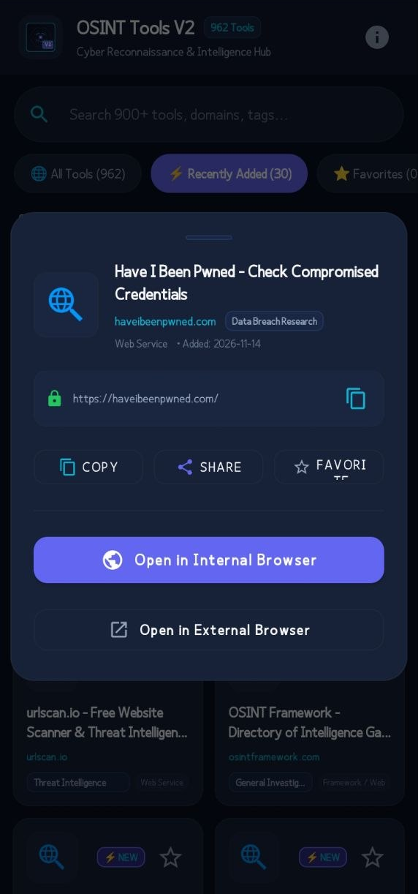

# OSINT Tools V2

<p align="center">
  <strong>A modern Android directory for discovering Open-Source Intelligence resources.</strong><br />
  Explore, search, organize, and access hundreds of publicly available OSINT resources from one application.
</p>

<p align="center">
  <a href="https://github.com/margacis2/OSINT-Tools/releases">
    
  </a>
  
  
  
  <a href="https://github.com/Gameye98/OSINT-Tools">
    
  </a>
</p>

## Overview

OSINT Tools V2 is a redesigned and expanded version of the original Android application by [Gameye98](https://github.com/Gameye98/OSINT-Tools).

The application brings together a curated directory of publicly accessible OSINT websites and resources. It helps users discover useful services for researching publicly available information across different investigative areas.

This fork focuses on improving the Android experience through:
- A redesigned, modern interface.
- An organized directory with 30 categories.
- Search and filtering.
- Local favorites.
- An integrated WebView browser.
- An expanded collection of OSINT resources.
- A separate Android package identity so the original application can remain installed.

**Original project:** [Gameye98/OSINT-Tools](https://github.com/Gameye98/OSINT-Tools)  
**Fork maintainer:** [margacis2](https://github.com/margacis2)

---

## Screenshots

The following filenames are the intended names for the cropped screenshots. Ensure they match the actual files committed to `screenshots/`.

<p align="center">
  
  <br>
  <strong>Home Screen</strong>
</p>

<p align="center">
  
  <br>
  <strong>OSINT Categories</strong>
</p>

<p align="center">
  
  <br>
  <strong>Favorites</strong>
</p>

<p align="center">
  
  <br>
  <strong>Tool Details</strong>
</p>

<p align="center">
  
  <br>
  <strong>Internal Browser</strong>
</p>

<p align="center">
  
  <br>
  <strong>About</strong>
</p>

---

## Features

### 1. Modern Android Interface
- Material Design-inspired cyber-intelligence appearance.
- Dark navy interface with indigo and cyan accents.
- Responsive tool cards and adaptive grid layout.
- RecyclerView-based list rendering.
- Improved scrolling and icon caching.
- Clear search and empty-result states.

### 2. OSINT Directory
The application includes 962 resource records:

| Collection | Records |
| :--- | :--- |
| Original directory (`siteurl.dat`) | 932 |
| Additional resources (`recent_tools.dat`) | 30 |
| **Total** | **962** |

Resources are linked to their respective external websites. The application acts as a directory and does not own or operate those third-party services.

### 3. Thirty Investigation Categories
Browse resources using dedicated category filters:
- People Search
- Social Media Intelligence
- Username Investigation
- Email Intelligence
- Phone Number Intelligence
- Domain Intelligence
- DNS & Subdomain Enumeration
- IP Address Intelligence
- Network Reconnaissance
- Geolocation Intelligence
- Maps & Satellite Intelligence
- Image Intelligence
- Reverse Image Search
- Video & Media Intelligence
- Metadata Analysis
- Dark Web Monitoring Resources
- Threat Intelligence
- Malware Analysis Resources
- Data Breach Research
- Digital Forensics
- Archive & Historical Research
- Search Engines & Google Dorks
- Cryptocurrency Intelligence
- Company & Business Intelligence
- Public Records Research
- Developer & Code Intelligence
- General Investigation Tools

The category interface also includes:
- All Tools
- Recently Added
- Favorites

Category membership can overlap, allowing a resource to appear in multiple relevant categories.

### 4. Search and Filtering
- Search by resource name.
- Search by website address and domain.
- Combine text search with category filtering.
- View the number of matching resources.
- Reset filters when needed.

### 5. Favorites
- Save useful resources to Favorites.
- Remove resources from Favorites.
- Manage favorites locally on the device.
- Access saved resources through the Favorites category.

### 6. Tool Information and Quick Actions
The resource details interface provides:
- Resource name and domain.
- Full website address.
- Category and resource type information.
- Copy URL.
- Share URL through Android's sharing interface.
- Add or remove Favorites.
- Open using the integrated browser.
- Open using an external browser.

### 7. Integrated Browser
The built-in Android WebView browser includes:
- Modern browser navigation interface.
- Page title and website address.
- Loading progress indicator.
- Back and forward navigation.
- Reload and retry controls.
- Desktop browsing mode.
- File upload support.
- DownloadManager integration.
- PDF printing and export through Android PrintManager.
- Handling for supported external links and application intents.
- WebView renderer-crash recovery and error handling.

*The browser depends on the external website, Android WebView, and network availability. Some websites may restrict embedded browsers or require their own authentication.*

### 8. Recently Added Resources
An additional collection of 30 resources is maintained separately in `recent_tools.dat`.

Examples include:
- WhatsMyName
- Epieos
- Have I Been Pwned
- Intelligence X
- urlscan.io
- OSINT Framework
- CyberChef
- Web-Check
- Shodan
- Censys
- VirusTotal
- BGP Toolkit
- Bellingcat Investigation Toolkit
- FotoForensics
- Aperi'Solve
- SunCalc
- Breadcrumbs
- Etherscan
- Sherlock
- Maigret
- Blackbird
- Social Analyzer
- Toutatis
- Sublist3r
- OWASP Amass
- PhoneInfoga
- Osintgram
- SpiderFoot
- OCCRP Aleph

*These resources are third-party projects and services. Their availability, features, and access requirements may change independently.*

---

## App Identity

OSINT Tools V2 uses a separate Android application ID.

| Property | Value |
| :--- | :--- |
| Application name | OSINT Tools V2 |
| Package ID | `com.margacis2.osinttools` |
| Original package ID | `com.gameye98.osint` |
| Version name | 2.0 |
| Version code | 6 |
| Minimum Android SDK | 21 |
| Target Android SDK | 34 |
| Programming language | Java |
| Java compatibility | Java 17 |

Because the application IDs are different, the V2 application can be installed alongside the original Gameye98 application without replacing it.

---

## Installation

### Download
1. Visit the repository's [GitHub Releases](https://github.com/margacis2/OSINT-Tools/releases) page to find available builds.
2. Download the release APK.
3. Open the downloaded APK on your Android device.
4. Allow installation from the relevant source if Android requests permission.
5. Install and launch OSINT Tools V2.

*The original Gameye98 app does not need to be uninstalled.*

### Compatibility
- Android 5.0 (Lollipop) and later.
- Internet connection required to access external OSINT websites.
- Individual websites may have their own account, subscription, regional, or API requirements.

---

## Build from Source

### Requirements
- JDK 17
- Android SDK
- Android SDK Platform 34
- Android Build Tools 34.0.0
- Gradle Wrapper included in the project

### Clone the repository
```bash
git clone https://github.com/margacis2/OSINT-Tools.git
cd OSINT-Tools
```

### Run unit tests
**Windows:**
```powershell
.\gradlew.bat testDebugUnitTest
```
**Linux/macOS:**
```bash
./gradlew testDebugUnitTest
```

### Build Debug APK
**Windows:**
```powershell
.\gradlew.bat assembleDebug
```
**Linux/macOS:**
```bash
./gradlew assembleDebug
```

### Build Release APK
**Windows:**
```powershell
.\gradlew.bat assembleRelease
```
**Linux/macOS:**
```bash
./gradlew assembleRelease
```

### APK output locations
```text
app/build/outputs/apk/
├── debug/
│   └── app-debug.apk
└── release/
    └── app-release.apk
```

---

## Project Structure

```text
OSINT-Tools/
│
├── app/
│   ├── src/
│   │   ├── main/
│   │   │   ├── assets/
│   │   │   │   ├── siteurl.dat
│   │   │   │   ├── recent_tools.dat
│   │   │   │   ├── user_agent.txt
│   │   │   │   └── icons/
│   │   │   │
│   │   │   ├── java/
│   │   │   │   └── com/gameye98/osint/
│   │   │   │       ├── MainActivity.java
│   │   │   │       ├── Browser.java
│   │   │   │       ├── OsintTool.java
│   │   │   │       ├── ToolAdapter.java
│   │   │   │       ├── FavoritesManager.java
│   │   │   │       ├── IconManager.java
│   │   │   │       └── PermissionUtils.java
│   │   │   │
│   │   │   └── res/
│   │   │       ├── drawable/
│   │   │       ├── layout/
│   │   │       └── values/
│   │   │
│   │   └── test/
│   │
│   ├── build.gradle
│   └── proguard-rules.pro
│
├── screenshots/
├── build.gradle
├── gradle.properties
├── gradlew
├── gradlew.bat
└── README.md
```

---

## Responsible Use

This application provides convenient access to publicly available information resources.

Please:
- Use OSINT resources only for lawful and authorized research.
- Respect privacy, applicable laws, and website terms of service.
- Do not use these resources for harassment, stalking, unauthorized access, or other harmful activities.
- Verify information using reliable sources before drawing conclusions.
- Respect the individual terms, licenses, and usage restrictions of third-party tools.

*The application is a directory of external resources. It does not guarantee the accuracy, availability, safety, or legality of third-party services.*

---

## Credits and Acknowledgements

This project is based on the original work of:
- **Original author:** [Gameye98](https://github.com/Gameye98)
- **Original repository:** [Gameye98/OSINT-Tools](https://github.com/Gameye98/OSINT-Tools)
- **Original community:** [BlackHole Security](https://github.com/BlackHoleSecurity)
- **Fork maintainer and modifications:** [margacis2](https://github.com/margacis2)

All original authors and contributors retain credit for their respective work.

This repository is a modified fork, not an official release from the original project maintainer.

---

## License

The upstream README displays an MIT license badge. However, a LICENSE file was not present in the upstream or fork repository when this README was prepared.

Please consult the original project maintainer and add the applicable license text before redistributing this modified project.

<p align="center">
  <strong>OSINT Tools V2</strong><br>
  Maintained by <a href="https://github.com/margacis2">margacis2</a><br>
  Based on the original work by Gameye98 and BlackHole Security.
</p>
